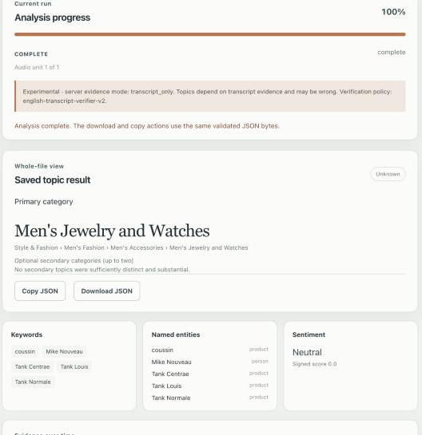

# Contextual Engine

**Contextual Engine** is a local application for Apple Silicon Macs that works out what an audio or video file is *about*. It listens to the English speech (or intelligible English lyrics), transcribes it, and assigns topic categories from the [IAB Content Taxonomy 3.1](https://iabtechlab.com/standards/content-taxonomy/), the standard used for contextual advertising. Results are exported as an OpenRTB `content` object.

Everything runs on your Mac. After a one-time setup, no audio, transcript, or result leaves the machine.



*Result for a 60-second watch review: one verified primary topic, plus keywords, entities, and sentiment taken from the transcript.*

> **Status: experimental (v0.1.0).** Labels can be wrong, and the engine often declines to label a file rather than guess. It has not been blind-evaluated. Read [Limitations](#limitations) before relying on its output.

---

## Contents

- [What it does](#what-it-does)
- [How it works](#how-it-works)
- [Project structure](#project-structure)
- [Requirements](#requirements)
- [Installation](#installation)
- [Configuration](#configuration)
- [Running the application](#running-the-application)
- [Output format](#output-format)
- [HTTP API](#http-api)
- [Limitations](#limitations)
- [Development](#development)
- [Documentation](#documentation)
- [License](#license)

---

## What it does

Give it a podcast, a product review, a TV programme, a tutorial, or a music video with English vocals. It returns:

- **One primary topic** and **up to two secondary topics**, as IAB Content Taxonomy 3.1 categories (for example *Men's Jewelry and Watches*, or *Sports* plus *Travel*).
- **How the topics were chosen:** one dominant topic, a broader parent topic covering several related subtopics, or two or three co-equal topics.
- **Keywords, named entities, and overall sentiment** taken from the transcript.
- **A time-coded transcript and evidence timeline** showing which parts of the speech support each topic.
- **A coverage report** listing any ranges it excluded (music, silence, non-English speech) or could not process.

**Features**

- Accepts `.wav`, `.mp4`, `.mov`, `.m4a`, `.mp3`, `.mkv`, and `.webm`. For video files, only the selected audio track is analysed.
- Three ways to submit: a local file path, a browser upload (up to 1 GiB), or a whole folder.
- A browser interface with live progress, cancellation, and saved results that survive a restart.
- Every topic must be backed by transcript segments that a second model call independently checks. When the evidence is weak, the engine reports "not enough topical evidence" instead of guessing.
- Fully offline after setup. Model files are pinned to exact versions and checksum-verified before every launch.

**Out of scope:** video frames, instrumental music, sound effects, silence, non-English speech, and music genre or mood.

## How it works

```text
Media file (path, upload, or folder)
  │
  ├─ ffprobe / ffmpeg ........ pick and normalise one audio track
  ├─ YAMNet (MLX) ............ is there speech or singing? (per 30 s window)
  ├─ Whisper (MLX) ........... detect language; transcribe English with timestamps
  ├─ Qwen3 Embedding (MLX) ... shortlist the 15 most relevant IAB categories
  ├─ Qwen3.6-35B-A3B (MLX) ... classify each ~90 s transcript window
  ├─ Qwen3.6 verifier ........ confirm each category against cited transcript lines
  ├─ Whole-file policy ....... exclude out-of-scope ranges, choose the final topics
  └─ Export .................. validated OpenRTB content JSON
```

**Whole-file policy (`english-audio-aggregation-v3`):**

1. **Exclusions.** Music breaks and silence are excluded anywhere in the file. Non-English speech and ranges that failed processing are excluded as long as each stays at or below **20%**; beyond that, the job stops with an explanation.
2. **Single topic.** A category wins if its verified evidence covers **more than 50%** of the usable speech and **at least 25%** of the audio.
3. **Parent rollup.** Otherwise, the most specific broader category whose subtopics together pass those thresholds (for example *Sports* for a show covering baseball, basketball, and soccer).
4. **Multi-topic.** Otherwise, two or three unrelated categories, each covering **at least 20%** of the speech, that together pass the thresholds.
5. **Otherwise** the job ends with *not enough topical evidence*, and no label is forced.

These thresholds are policy rules, not confidence scores.

## Project structure

```text
audio_contextual_engine/
├── run.sh                  Start the app (./run.sh) or check the install (./run.sh --check)
├── pyproject.toml, uv.lock Exact Python dependencies
├── engine/                 Application code
│   ├── ingest/             ffprobe/ffmpeg audio extraction and windowing
│   ├── transcribe/         Vocal screening, language gate, transcription
│   ├── models/             MLX model adapters (Whisper, Qwen, YAMNet) and model registry
│   ├── signals/            Retrieval, classification, verification, whole-file policy
│   ├── ortb/               OpenRTB content builder and validator
│   ├── web/                FastAPI server, live updates (SSE), browser UI in static/
│   ├── pipeline.py         End-to-end job orchestration
│   ├── runner.py           Background job worker
│   └── store.py            Durable job records on disk
├── scripts/                Setup, model download/import, checks, evaluation tools
├── tests/                  Deterministic test suite (no model downloads needed)
├── data/standards/         Vendored IAB taxonomy with checksum provenance
└── docs/                   Setup guide, design overview, verification records
```

Created locally and excluded from Git: `.venv/` (Python environment), `data/models/` (model weights and search index), `data/jobs/` (saved results), and `data/uploads/` (staged uploads).

## Requirements

### Hardware and operating system

| Requirement | Minimum |
| --- | --- |
| Computer | Apple Silicon Mac (M1 or later), running natively, not under Rosetta |
| Operating system | macOS 14 Sonoma or newer |
| Memory | **64 GB unified memory.** The startup check refuses to run with less. |
| Free disk space | **40 GB** for setup (about 24 GB of models plus the environment and temporary files) |
| Network | Needed only for the one-time setup |

Intel Macs, Windows, and Linux are not supported. The engine has been tested on a 64 GB M1 Max; peak memory use there was about 22 GB.

### Software

| Tool | Purpose | Install |
| --- | --- | --- |
| [uv](https://docs.astral.sh/uv/) | Creates the locked Python 3.11–3.13 environment | `brew install uv` |
| [FFmpeg](https://ffmpeg.org/) (`ffmpeg`, `ffprobe`) | Reads media and extracts audio | `brew install ffmpeg` |
| [Homebrew](https://brew.sh/) | Installs the two tools above | See brew.sh |

All Python packages are pinned in `uv.lock`. The runtime uses Apple's [MLX](https://github.com/ml-explore/mlx) on the GPU; PyTorch and TensorFlow are deliberately not installed.

### Models

Setup downloads these pinned models into `data/models/`. They are not included in this repository.

| Role | Model | Size on disk |
| --- | --- | ---: |
| Classification and verification | [mlx-community/Qwen3.6-35B-A3B-4bit](https://huggingface.co/mlx-community/Qwen3.6-35B-A3B-4bit) | ~20.4 GB |
| Speech recognition | [mlx-community/whisper-large-v3-turbo-asr-fp16](https://huggingface.co/mlx-community/whisper-large-v3-turbo-asr-fp16) | ~1.6 GB |
| Category retrieval | [mlx-community/Qwen3-Embedding-4B-4bit-DWQ](https://huggingface.co/mlx-community/Qwen3-Embedding-4B-4bit-DWQ) | ~2.3 GB |
| Speech/singing detection | [YAMNet](https://github.com/tensorflow/models/tree/c14bf9ad91962cf189f9f58db2132c06247fcd53/research/audioset/yamnet), converted to MLX during setup | ~15 MB |

Exact revisions and checksums are recorded in `engine/models/registry.py` and in the manifests that setup writes. Licence details are in [THIRD_PARTY_NOTICES.md](THIRD_PARTY_NOTICES.md); review them before redistributing any model files.

## Installation

These steps take a fresh Mac to a running app. Detailed explanations and troubleshooting are in the [step-by-step setup guide](docs/setup-guide.md).

**1. Check the Mac.**

```sh
uname -m                  # must print arm64
sw_vers -productVersion   # must be 14 or higher
sysctl -n hw.memsize      # must be at least 68719476736 (64 GB)
```

**2. Install the command-line tools.** If Homebrew is missing, install it from [brew.sh](https://brew.sh/) first.

```sh
brew install uv ffmpeg
```

**3. Clone the repository** into a permanent location. The environment and model manifests record absolute paths, so moving the folder later means re-running setup.

```sh
git clone https://github.com/willlightningstrike/audio_contextual_engine.git
cd audio_contextual_engine
```

**4. Create the Python environment.**

```sh
uv sync --locked --python 3.13
```

**5. Convert YAMNet (one time).** YAMNet is distributed as a TensorFlow model. This step converts it to MLX inside a throwaway environment, so TensorFlow never enters the application environment.

```sh
uv venv --python 3.11 .yamnet-reference
uv pip install --python .yamnet-reference/bin/python tensorflow==2.19.1 tf-keras==2.19.0
.yamnet-reference/bin/python -m scripts.prepare_yamnet --output "$PWD/.yamnet-prepared"
```

**6. Download the models and build the search index.** This is a large download (about 24 GB).

```sh
bash scripts/setup.sh "$PWD/.yamnet-prepared"
```

**7. Verify the installation.**

```sh
./run.sh --check
```

A successful check ends with `Contextual Engine setup passed; local assets verified.` If it fails, see [Troubleshooting](docs/setup-guide.md#e-troubleshooting). Once this passes, you can delete `.yamnet-reference/` and `.yamnet-prepared/`.

Already have a verified model bundle from another install? Skip steps 5–6 and [import it offline](docs/setup-guide.md#d-optional-import-an-existing-model-bundle) instead.

## Configuration

Most users need no configuration.

| Setting | Default | How to change |
| --- | --- | --- |
| Data folder (models, jobs, uploads) | `data/` inside the project | Set the `CONTEXTUAL_ENGINE_DATA_DIR` environment variable before `./run.sh` |
| Server address | `http://127.0.0.1:8765` (this Mac only) | Fixed in `engine/config.py` |
| Upload size limit | 1 GiB | Fixed in `engine/config.py`; use a local path for larger files |
| Allowed local paths | Files inside your home folder | Fixed in `engine/config.py` |
| Supported file types | `.wav .mp4 .mov .m4a .mp3 .mkv .webm` | Fixed in `engine/config.py` |
| Unclaimed upload expiry | 24 hours | Fixed in `engine/config.py` |

Example using a different data folder:

```sh
CONTEXTUAL_ENGINE_DATA_DIR="$HOME/ContextualEngineData" ./run.sh --check
CONTEXTUAL_ENGINE_DATA_DIR="$HOME/ContextualEngineData" ./run.sh
```

The setup script and the server must use the same data folder. The server only listens on `127.0.0.1` and has no login, so it is meant for one person on one Mac.

## Running the application

**1. Start the server** from the project folder:

```sh
./run.sh
```

Leave the Terminal window open. Startup verifies the model files and loads the index, which can take a little while.

**2. Open** [http://127.0.0.1:8765](http://127.0.0.1:8765) in a browser on the same Mac.

**3. Choose a source.**
- **Use a local file path:** paste the full path, for example `/Users/you/Media/interview.mp4` (no quotes or `file://`). Preferred for large files, because nothing is copied.
- **Upload a file:** pick a file up to 1 GiB.
- **Analyze a folder:** paste a folder path. Each supported file directly inside it becomes its own job.

**4. Click "Check audio track"**, then pick the English audio track if the file has more than one. Leave **Content context** on *Automatic* unless you need to override the OpenRTB context value. For a song or music video, choose *Music* (see [Limitations](#limitations)).

**5. Click "Start analysis".** Progress shows the current stage, the audio window being processed, and verification results as they are saved. You can **Cancel** at any time; the current step finishes first.

**6. Read the result.**
- **Saved topic result:** the primary category, any secondary categories, and notes such as *Multi-topic*, *Broader topic*, or *Partial coverage*.
- **Not enough topical evidence in the audio:** the speech didn't support a defensible topic. This is a normal outcome, not an error.
- **Out of scope or stopped:** for example, more than 20% of the speech wasn't English. The message explains why.

Below the result you'll find keywords, entities, the evidence timeline, the transcript, and a coverage list of excluded or failed ranges.

**7. Export.** **Copy JSON** and **Download JSON** return the same validated file. They are only available for successfully completed jobs.

**8. Stop the server** with **Control-C** in its Terminal window. Saved jobs remain in `data/jobs/` and reappear the next time you start.

## Output format

A successful job exports an [OpenRTB 2.6](https://iabtechlab.com/standards/openrtb/) `content` object. `cattax: 9` means IAB Content Taxonomy 3.1; `cat` lists the primary category first. Illustrative example:

```json
{
  "cat": ["581"],
  "cattax": 9,
  "context": 7,
  "language": "en",
  "len": 60,
  "kwarray": ["Tank Louis", "Tank Normale", "Mike Nouveau"],
  "data": [{
    "name": "contextual_engine",
    "segment": [
      {"id": "sentiment", "value": "neutral:0.0"},
      {"id": "entity_product", "value": "Tank Louis"},
      {"id": "entity_person", "value": "Mike Nouveau"},
      {"id": "primary_category", "value": "581"},
      {"id": "aggregation_policy", "value": "english-audio-aggregation-v3"},
      {"id": "topic_structure", "value": "single"},
      {"id": "coverage", "value": "complete"}
    ]
  }]
}
```

| Segment | Meaning |
| --- | --- |
| `primary_category`, `secondary_category` | Category roles, in the same order as `cat` |
| `topic_structure` | `single`, `parent_rollup` (broader parent topic), `multi_topic` (co-equal topics), or `declared_music` (Music chosen as the content context) |
| `coverage` | `complete`, or `partial_technical_failures` if some ranges failed and were left out |
| `sentiment` | `label:score`, with the score from −1 to 1. Omitted from a `declared_music` result with no verified transcript evidence |
| `entity_<type>` | Named entities found in the transcript |

Keyword, entity, and sentiment values are model outputs, not calibrated probabilities. Only the categories are independently verified.

## HTTP API

The browser interface uses a small JSON API on the same address, which you can also call directly:

| Method and path | Purpose |
| --- | --- |
| `POST /api/media/probe-path` | Inspect a local file's audio tracks |
| `POST /api/jobs/path` | Start a job from a local path |
| `POST /api/uploads`, then `POST /api/jobs/upload` | Upload a file, then start a job from it |
| `POST /api/batches/path` | Start jobs for every supported file in a folder |
| `GET /api/jobs/{id}` | Job status, transcript, timeline, and coverage |
| `GET /api/jobs/{id}/events` | Live updates (server-sent events) |
| `POST /api/jobs/{id}/cancel` | Cancel a job |
| `GET /api/jobs/{id}/export` | Download the validated result JSON |
| `GET /api/batches/{id}`, `POST /api/batches/{id}/cancel` | Folder batch status and cancellation |
| `GET /api/taxonomy` | The IAB category list |

Example:

```sh
curl -s -X POST http://127.0.0.1:8765/api/jobs/path \
  -H 'Content-Type: application/json' \
  -d '{"path": "/Users/you/Media/interview.mp4"}'
```

## Limitations

- **English only.** Files where more than 20% of the speech is not English are out of scope.
- **Transcript only.** No video-frame analysis, and no music genre or mood. A file with little speech usually gets no label.
- **Music and music videos.** Music (338), its genres and Music Video (650) are never inferred from the audio: a transcript cannot show genre, and lyrics rarely support a real topic. Songs therefore usually end with "not enough topical evidence". To label one, set **Content context** to *Music* (`requested_context: 3`). The result then leads with Music, adds Music Video for video files, and keeps any verified transcript topic as a secondary. This label is declared by you, not detected. Instrumental tracks and non-English songs still fail the vocal and language checks.
- **Often returns no label.** If a file has little speech, mixed topics, or speech the verifier can't confirm, the engine reports "not enough topical evidence" rather than guessing. This is expected behaviour, not an error.
- **Shared model for checking.** The same Qwen3.6 model proposes and verifies categories, so they can make the same mistake. Known errors in testing include coffee-brewing clips labelled *Cooking* instead of *Non-Alcoholic Beverages*.
- **Heavy and slow.** It needs a 64 GB Apple Silicon Mac. The median was about 67 seconds per labelled file in the 308-file test with the earlier Qwen2.5 model; long programmes can take over an hour.
- **Single user.** No authentication, and loopback only. Saved jobs keep transcripts and filenames until you delete them from `data/jobs/`.

The [capabilities and limitations review](docs/capabilities-and-limitations-review.md) and the [application overview](docs/application-overview.md) have the full details.

## Development

Run the deterministic test suite (no models or network needed):

```sh
uv run pytest -q -m "not real_models"
```

Other checks:

```sh
uv run python scripts/audit_dependencies.py   # pinned versions, no PyTorch/TensorFlow
uv run python scripts/audit_imports.py        # import boundaries
uv build --wheel && uv run python scripts/smoke_wheel.py
```

The wheel contains the application code, browser UI, and IAB standards data, but no model weights.

## Documentation

- [Step-by-step setup guide](docs/setup-guide.md): installation, first use, troubleshooting, where files are stored
- [Application overview](docs/application-overview.md): design, models, storage, evaluation
- [Capabilities and limitations review](docs/capabilities-and-limitations-review.md)
- [Third-party notices](THIRD_PARTY_NOTICES.md): model and data licences

## License

The application source code is released under the [MIT License](LICENSE).

The models and the IAB taxonomy are third-party assets with their own licences (Apache-2.0, MIT, and CC BY 3.0). See [THIRD_PARTY_NOTICES.md](THIRD_PARTY_NOTICES.md). The MIT License does not cover them.
